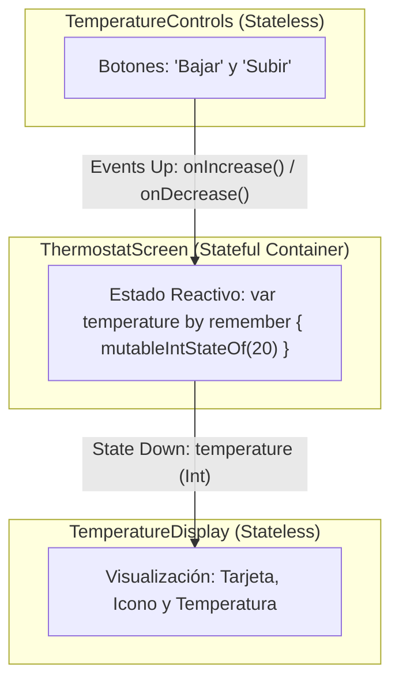
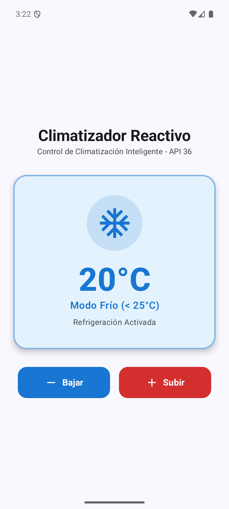
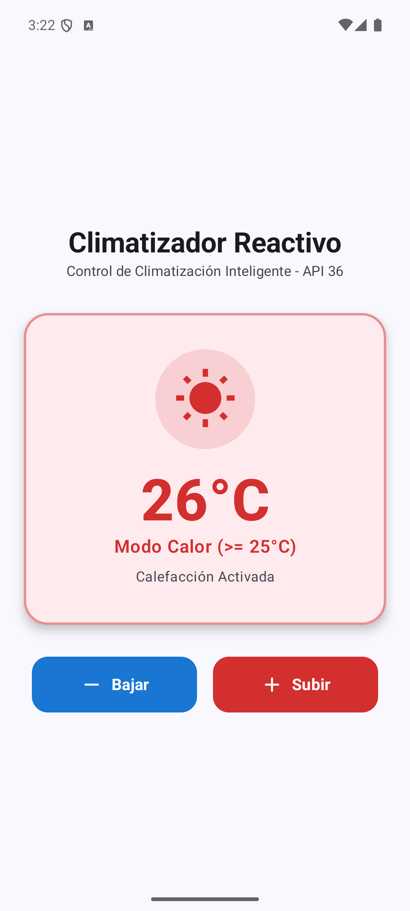

# INFORME TÉCNICO DE LABORATORIO
## LABORATORIO 5.2 / 5.3: RETO INTEGRADOR – IMPLEMENTACIÓN DE UN TERMOSTATO INTELIGENTE (CLIMATIZADOR REACTIVO)

---

**Institución:** Pontificia Universidad Católica del Ecuador (PUCE)  
**Facultad:** Facultad de Hábitat, Infraestructura y Creatividad  
**Carrera:** Ingeniería en Tecnologías de la Información / Sistemas  
**Asignatura:** Redes y Dispositivos Avanzados 2 (RDA-2) / Programación Móvil  
**Docente:** Dr. Juan Francisco Chafla, PhD.  
**Semestre:** 2026  
**Grupo:** Reto Grupo 1  
**Estudiante(s):** Paul Rosero  
**Fecha de Entrega:** 23 de Octubre de 2026  
**Repositorio GitHub:** [RDA2_Lab5.3_Reto_Grupo1](https://github.com/paulrosero/RDA2_Lab5.3_Reto_Grupo1)  
**Commit Final:** `e0b199a` (`feat(termostato): implementacion completa del climatizador reactivo con Jetpack Compose y State Hoisting`)  

---

## 1. INTRODUCCIÓN Y CONTEXTUALIZACIÓN

El desarrollo de interfaces móviles en la plataforma Android ha experimentado una transformación estructural fundamental con la llegada de **Jetpack Compose**, el kit de herramientas declarativo moderno adoptado formalmente a partir de las versiones recientes del sistema operativo, consolidándose como estándar mandatario para **Android API 36**. 

Tradicionalmente, en el **paradigma imperativo**, la interfaz gráfica de usuario (UI) se definía en archivos XML desacoplados de la lógica programática (implementada en Java o Kotlin). Para alterar la interfaz, el desarrollador debía obtener referencias explícitas a los nodos mediante llamadas a `findViewById`, almacenar estados intermedios manualmente y sincronizar la vista invocando setters como `setText()`, `setTextColor()` o `setVisibility()`. Esta aproximación introducía una alta fragilidad y el temido riesgo de **desincronización entre el estado lógico de la aplicación y la interfaz visual**, puesto que la omisión de un único setter en cualquier flujo de eventos conducía a estados inconsistentes y errores difíciles de depurar en aplicaciones de escala comercial.

En contraste, el **paradigma declarativo** propone una filosofía diametralmente opuesta: **la interfaz de usuario es una función pura del estado** ($UI = f(State)$). El programador ya no describe el *"cómo"* realizar paso a paso cada cambio en los widgets existentes, sino el *"qué"* debe mostrarse en la pantalla según el conjunto de datos de entrada en un instante determinado.

El presente laboratorio práctico tiene como finalidad diseñar e implementar un **Panel de Control de Climatización Reactivo (Termostato Inteligente)**, empleando las directrices de arquitectura reactiva, elevación de estado (**State Hoisting**), desacoplamiento entre componentes con estado (**Stateful**) y sin estado (**Stateless**), y el ciclo de vida de **recomposición inteligente** en Jetpack Compose sobre Android API 36.

---

## 2. OBJETIVOS DE APRENDIZAJE

### 2.1 Objetivo General
Desarrollar un panel de control de climatización funcional y reactivo en Android API 36 utilizando Jetpack Compose, garantizando que los cambios de temperatura actualicen de forma instantánea y automática la apariencia visual (tipografía, colores e iconografía) basándose exclusivamente en el flujo unidireccional de datos y la gestión del estado.

### 2.2 Objetivos Específicos
1. **Diferenciación de Paradigmas:** Contrastar de manera práctica y teórica las ventajas del modelo declarativo de Jetpack Compose frente al modelo imperativo basado en layouts XML y `findViewById`.
2. **Elevación de Estado (State Hoisting):** Implementar una arquitectura limpia donde el componente contenedor padre (`ThermostatScreen`) gobierne la única fuente de verdad y delegue la visualización a componentes hijos completamente desacoplados.
3. **Flujo Unidireccional de Datos (UDF):** Aplicar el patrón *State Down, Events Up*, permitiendo que el estado descienda hacia la visualización mediante parámetros inmutables y los eventos de usuario asciendan al contenedor mediante funciones lambda de orden superior.
4. **Recomposición Inteligente:** Verificar el mecanismo de recomposición selectiva que minimiza la sobrecarga computacional redibujando únicamente los nodos suscritos a cambios de estado.
5. **Calidad de Diseño y Ergonomía Visual:** Construir una interfaz moderna, limpia y ergonómica mediante el uso de modificadores (`padding`), contenedores estructurales (`Column`, `Row`, `Card`) y espaciadores explícitos (`Spacer`).

---

## 3. MARCO TEÓRICO Y CONCEPTUAL (TEMA 5)

Basado en las lecciones impartidas en el **Tema 5: Cambio de Paradigma: UI Declarativa**, se fundamentan los siguientes conceptos clave:

### 3.1 Imperativo vs Declarativo: "Cómo vs Qué"
* **Paradigma Imperativo:** Sigue la metáfora del *"manual de instrucciones paso a paso"* (*"Camina 5 pasos, busca el botón, cambia su texto, busca el icono, cambia su color"*). Si un paso falla o se omite, la interfaz queda en un estado inválido.
* **Paradigma Declarativo:** Sigue la *"metáfora de la silla"* (*"Quiero estar sentado"*). Se describe el estado final deseado. Compose se encarga de determinar qué elementos deben crearse, actualizarse o descartarse en el árbol de composición para reflejar fielmente dicho estado.

| Característica | Paradigma Imperativo (XML + Java/Kotlin) | Paradigma Declarativo (Jetpack Compose) |
| :--- | :--- | :--- |
| **Definición de UI** | Archivos XML estáticos separados del código lógico. | Funciones `@Composable` en Kotlin con un DSL especializado. |
| **Acceso a Elementos** | `findViewById()`, ViewBinding o DataBinding. | No existen IDs ni referencias mutables directas a vistas. |
| **Actualización de UI** | Llamadas manuales a setters (`setText`, `setColor`). | Automática por reactividad ante mutaciones de estado ($UI = f(State)$). |
| **Riesgo de Inconsistencia** | Alto (fuente de verdad dispersa entre código y vistas). | Nulo (la UI siempre es un reflejo exacto del estado actual). |
| **Equivalente en iOS** | UIKit / Storyboards (Autolayout imperativo). | SwiftUI (`VStack`, `HStack`, `@State`). |

### 3.2 Gestión del Estado: `remember` y `mutableIntStateOf`
Para que una variable provoque cambios visuales automáticos en Jetpack Compose, debe poseer reactividad y persistencia:
1. **`mutableIntStateOf(valorInicial)` (El Observador):** Es una estructura de estado observable primitive-optimized (evita el boxing de enteros de `mutableStateOf<Int>`). Cuando su propiedad interna `.intValue` sufre una modificación, Compose registra automáticamente la mutación y planifica la recomposición de todas las funciones `@Composable` que hayan leído ese valor.
2. **`remember` (La Memoria):** Las funciones composables se ejecutan reiteradas veces durante el ciclo de vida de la aplicación. Si declarásemos una variable local normal dentro de la función, su valor se reinicializaría en cada recomposición. El bloque `remember { ... }` actúa como la memoria del componente, preservando la instancia del estado a lo largo de las recomposiciones mientras el nodo permanezca en el árbol de composición.

### 3.3 Árbol de Composición y Recomposición Inteligente
Compose construye internamente una estructura jerárquica de nodos conocida como el **Árbol de Composición**. Cada nodo almacena los parámetros recibidos y las variables de estado que observa.
* **Skipping (Omisión Inteligente):** Cuando el estado de la temperatura cambia de 20°C a 21°C, Compose evalúa el árbol. Los nodos estáticos (como el título `"Climatizador Reactivo"`) no leen dicha variable, por lo que Compose los omite completamente durante la recomposición.
* **Analogía de Hoja de Cálculo (Excel):** Al modificar el valor de una celda en una hoja de cálculo, no se recalculan todas las fórmulas del libro, sino únicamente aquellas que dependen directa o indirectamente de la celda alterada. De igual manera, Compose redibuja solo los componentes dependientes de `temperature`.

### 3.4 Patrón de Elevación de Estado (State Hoisting) y Flujo Unidireccional (UDF)
El *State Hoisting* consiste en extraer el estado de un componente para convertirlo en un componente sin estado (**Stateless**).
* **Componente Stateful (`ThermostatScreen`):** Posee y gestiona el estado mutable (`temperature`). Actúa como la única fuente de verdad (*Single Source of Truth*).
* **Componentes Stateless (`TemperatureDisplay`, `TemperatureControls`):** No retienen ningún estado interno ni mutan variables directamente. Reciben datos inmutables y emiten eventos:
  * **State Down (El estado desciende):** `ThermostatScreen` pasa el entero inmutable `temperature` a `TemperatureDisplay`.
  * **Events Up (Los eventos ascienden):** `TemperatureControls` recibe acciones del usuario (pulsaciones de botones) y las comunica al padre invocando lambdas de devolución de llamada: `onIncrease: () -> Unit` y `onDecrease: () -> Unit`.



---

## 4. ESPECIFICACIÓN Y DISEÑO DEL RETO

El reto exige cumplir estrictamente con los siguientes requisitos funcionales y técnicos:

1. **Contenedor Principal:** Implementación de la función Composable `ThermostatScreen` como componente padre en `MainActivity.kt`.
2. **Definición de Estado:** Uso exclusivo de `remember` y `mutableIntStateOf` inicializado en 20.
3. **Jerarquía de Subcomponentes Hijos:**
   * **Componente de Visualización (`TemperatureDisplay`):** Recibe la temperatura como parámetro. Debe ser estrictamente *Stateless*.
   * **Componente de Controles (`TemperatureControls`):** Contiene botones (Subir/Bajar) sin lógica interna, ejecutando lambdas provistas por el padre.
4. **Lógica Declarativa Condicional:**
   * $\text{Temperatura} \ge 25^\circ\text{C}$: Modo Calor $\rightarrow$ Texto e Icono en color **Rojo** (Icono de Sol: `Icons.Filled.WbSunny`).
   * $\text{Temperatura} < 25^\circ\text{C}$: Modo Frío $\rightarrow$ Texto e Icono en color **Azul** (Icono de Copo de Nieve: `Icons.Filled.AcUnit`).
5. **Requisitos Técnicos:**
   * Prohibición absoluta de `findViewById` o archivos de maquetación XML.
   * Uso de modificadores `padding` y componentes `Spacer` para respetar márgenes y espaciados armónicos.
   * Ejecución y validación en emulador con **Android API 36**.

---

## 5. DESARROLLO E IMPLEMENTACIÓN TÉCNICA

### 5.1 Configuración de Dependencias (`gradle/libs.versions.toml` y `app/build.gradle.kts`)
Para disponer de la iconografía de Material Design (`WbSunny`, `AcUnit`, `Add`, `Remove`), se configuró la biblioteca `material-icons-extended` gestionada armónicamente a través del Bill of Materials (BOM) de Jetpack Compose:

**Extracto de `gradle/libs.versions.toml`:**
```toml
[libraries]
androidx-material3 = { group = "androidx.compose.material3", name = "material3" }
androidx-compose-material-icons-extended = { group = "androidx.compose.material", name = "material-icons-extended" }
```

**Extracto de `app/build.gradle.kts`:**
```kotlin
dependencies {
    implementation(platform(libs.androidx.compose.bom))
    implementation(libs.androidx.ui)
    implementation(libs.androidx.ui.graphics)
    implementation(libs.androidx.ui.tooling.preview)
    implementation(libs.androidx.material3)
    implementation(libs.androidx.compose.material.icons.extended)
    // ...
}
```

### 5.2 Estructura del Código en `MainActivity.kt`
El código fuente fue desarrollado implementando buenas prácticas de clean code, nomenclatura semántica y documentación detallada.

#### A. Contenedor Padre Stateful: `ThermostatScreen`
```kotlin
@Composable
fun ThermostatScreen(modifier: Modifier = Modifier) {
    // Estado reactivo: única fuente de verdad inicializada en 20°C
    var temperature by remember { mutableIntStateOf(20) }

    Column(
        modifier = modifier
            .fillMaxSize()
            .background(MaterialTheme.colorScheme.background)
            .padding(24.dp),
        horizontalAlignment = Alignment.CenterHorizontally,
        verticalArrangement = Arrangement.Center
    ) {
        Text(
            text = "Climatizador Reactivo",
            style = MaterialTheme.typography.headlineMedium,
            fontWeight = FontWeight.Bold
        )
        Text(
            text = "Control de Climatización Inteligente - API 36",
            style = MaterialTheme.typography.bodyMedium,
            color = MaterialTheme.colorScheme.onSurfaceVariant
        )

        Spacer(modifier = Modifier.height(32.dp))

        // State Down: El estado desciende hacia el componente de visualización
        TemperatureDisplay(
            temperature = temperature,
            modifier = Modifier.fillMaxWidth()
        )

        Spacer(modifier = Modifier.height(32.dp))

        // Events Up: Los eventos ascienden hacia el padre mediante funciones lambda
        TemperatureControls(
            onIncrease = { temperature++ },
            onDecrease = { temperature-- },
            modifier = Modifier.fillMaxWidth()
        )
    }
}
```

#### B. Subcomponente de Visualización Stateless: `TemperatureDisplay`
```kotlin
@Composable
fun TemperatureDisplay(
    temperature: Int,
    modifier: Modifier = Modifier
) {
    // Lógica declarativa: derivación visual a partir del estado (UI = f(State))
    val isWarm = temperature >= 25
    val statusColor = if (isWarm) Color(0xFFD32F2F) else Color(0xFF1976D2)
    val backgroundColor = if (isWarm) Color(0xFFFFEBEE) else Color(0xFFE3F2FD)
    val icon = if (isWarm) Icons.Filled.WbSunny else Icons.Filled.AcUnit
    val statusLabel = if (isWarm) "Modo Calor (>= 25°C)" else "Modo Frío (< 25°C)"
    val descriptionText = if (isWarm) "Calefacción Activada" else "Refrigeración Activada"

    Card(
        modifier = modifier,
        shape = RoundedCornerShape(24.dp),
        colors = CardDefaults.cardColors(containerColor = backgroundColor),
        border = BorderStroke(2.dp, statusColor.copy(alpha = 0.5f)),
        elevation = CardDefaults.cardElevation(defaultElevation = 6.dp)
    ) {
        Column(
            modifier = Modifier
                .fillMaxWidth()
                .padding(vertical = 36.dp, horizontal = 24.dp),
            horizontalAlignment = Alignment.CenterHorizontally
        ) {
            Box(
                modifier = Modifier
                    .size(100.dp)
                    .clip(CircleShape)
                    .background(statusColor.copy(alpha = 0.15f)),
                contentAlignment = Alignment.Center
            ) {
                Icon(
                    imageVector = icon,
                    contentDescription = statusLabel,
                    tint = statusColor,
                    modifier = Modifier.size(64.dp)
                )
            }

            Spacer(modifier = Modifier.height(18.dp))

            Text(
                text = "$temperature°C",
                fontSize = 58.sp,
                fontWeight = FontWeight.ExtraBold,
                color = statusColor,
                textAlign = TextAlign.Center
            )

            Text(
                text = statusLabel,
                fontSize = 18.sp,
                fontWeight = FontWeight.SemiBold,
                color = statusColor
            )

            Spacer(modifier = Modifier.height(6.dp))

            Text(
                text = descriptionText,
                fontSize = 14.sp,
                color = MaterialTheme.colorScheme.onSurfaceVariant
            )
        }
    }
}
```

#### C. Subcomponente de Controles Stateless: `TemperatureControls`
```kotlin
@Composable
fun TemperatureControls(
    onIncrease: () -> Unit,
    onDecrease: () -> Unit,
    modifier: Modifier = Modifier
) {
    Row(
        modifier = modifier.padding(horizontal = 8.dp),
        horizontalArrangement = Arrangement.SpaceEvenly,
        verticalAlignment = Alignment.CenterVertically
    ) {
        Button(
            onClick = onDecrease,
            shape = RoundedCornerShape(16.dp),
            colors = ButtonDefaults.buttonColors(containerColor = Color(0xFF1976D2)),
            modifier = Modifier
                .weight(1f)
                .height(56.dp)
        ) {
            Icon(imageVector = Icons.Filled.Remove, contentDescription = "Bajar")
            Spacer(modifier = Modifier.width(8.dp))
            Text(text = "Bajar", fontSize = 16.sp, fontWeight = FontWeight.Bold)
        }

        Spacer(modifier = Modifier.width(16.dp))

        Button(
            onClick = onIncrease,
            shape = RoundedCornerShape(16.dp),
            colors = ButtonDefaults.buttonColors(containerColor = Color(0xFFD32F2F)),
            modifier = Modifier
                .weight(1f)
                .height(56.dp)
        ) {
            Icon(imageVector = Icons.Filled.Add, contentDescription = "Subir")
            Spacer(modifier = Modifier.width(8.dp))
            Text(text = "Subir", fontSize = 16.sp, fontWeight = FontWeight.Bold)
        }
    }
}
```

---

## 6. PRUEBAS, VALIDACIÓN Y RESULTADOS EXPERIMENTALES

La aplicación fue compilada e instalada en el emulador oficial de Android Studio: **Pixel 8 con imagen del sistema Android API 36**. Se llevaron a cabo las pruebas de reactividad y comprobación de la máquina de estados visual:

### 6.1 Validación del Estado "Frío" (Temperatura < 25°C)
* **Condición de prueba:** Valor inicial del termostato fijado en **20°C**.
* **Comportamiento observado:**
  * El contenedor central adquiere automáticamente una tonalidad azul suave (`#E3F2FD`).
  * El icono desplegado corresponde al copo de nieve (`Icons.Filled.AcUnit`) teñido en azul primario (`#1976D2`).
  * Los textos señalan `"20°C"`, `"Modo Frío (< 25°C)"` y `"Refrigeración Activada"`.
  * La interfaz no parpadea ni requiere recreación de la Activity.

**Evidencia experimental (Emulador API 36 - Estado Frío):**



---

### 6.2 Validación del Estado "Calor" (Temperatura $\ge$ 25°C)
* **Condición de prueba:** El usuario pulsa reiteradamente el botón **"Subir"**, alcanzando y superando el umbral de 25°C (por ejemplo, **26°C**).
* **Comportamiento observado:**
  * Al llegar a 25°C y 26°C, Compose recompone inmediatamente el nodo `TemperatureDisplay`.
  * El fondo conmuta a un rojo pastel cálido (`#FFEBEE`).
  * El icono cambia en tiempo real al icono de sol (`Icons.Filled.WbSunny`) en color rojo intenso (`#D32F2F`).
  * Los textos se actualizan instantáneamente a `"26°C"`, `"Modo Calor (>= 25°C)"` y `"Calefacción Activada"`.
  * Si el usuario pulsa nuevamente el botón **"Bajar"** hasta descender a 24°C, el sistema retorna fluidamente al estado azul de copo de nieve, demostrando la reactividad bidireccional continua del árbol de composición.

**Evidencia experimental (Emulador API 36 - Estado Calor):**



---

## 7. ANÁLISIS DE RESULTADOS Y DISCUSIÓN

1. **Eliminación del Código de "Fontanería" (*Boilerplate*):**
   En un desarrollo tradicional con vistas XML, habría sido necesario:
   - Crear un archivo `activity_main.xml` con `TextView`, `ImageView`, `Button`.
   - Crear selectores o drawables vectoriales estáticos.
   - En `MainActivity.java` o `.kt`, obtener referencias con `findViewById(R.id.tv_temp)`, `findViewById(R.id.iv_icon)`, etc.
   - Declarar un listener para cada botón y escribir un método como `actualizarVista(int temp)` con múltiples `setText`, `setColorFilter`, `setImageResource`.
   - Cualquier olvido dejaba la UI desincronizada.
   En Jetpack Compose, toda la relación visual quedó expresada en **6 líneas de código declarativo** dentro de `TemperatureDisplay`, donde la interfaz se deduce matemáticamente del estado: $UI = f(State)$.

2. **Rendimiento y Skipping en Recomposición:**
   Gracias a la utilización de `mutableIntStateOf(20)`, el compilador de Compose genera bytecode optimizado que evita la recompilación de la cabecera estática (`Text("Climatizador Reactivo")`) cuando cambia la temperatura. Solo el subárbol dependiente de `temperature` participa en el ciclo de recomposición.

3. **Desacoplamiento y Testabilidad (State Hoisting):**
   Al separar `TemperatureDisplay` y `TemperatureControls` de la variable de estado mutable, ambos componentes se tornaron 100% *Stateless*. Esto permitió declarar funciones de `@Preview` independientes (`ThermostatScreenColdPreview` y `ThermostatScreenWarmPreview`) que pueden visualizarse de inmediato en Android Studio Ladybug sin requerir simular eventos ni instanciar contextos de Android complejos.

---

## 8. CONCLUSIONES

1. **La UI Declarativa revoluciona el desarrollo móvil en API 36:** La premisa fundamental de Jetpack Compose ($UI = f(State)$) erradica definitivamente el problema clásico de desincronización entre la lógica y la interfaz gráfica, produciendo sistemas más predecibles, robustos y fáciles de mantener.
2. **El patrón State Hoisting garantiza arquitecturas limpias y reutilizables:** Elevar el estado al contenedor común padre (`ThermostatScreen`) convierte a los componentes hijos en piezas "Stateless" puras, las cuales reciben datos inmutables y delegan eventos mediante funciones lambda, facilitando pruebas unitarias y visualizaciones rápidas en tiempo de diseño.
3. **Optimización mediante Recomposición Inteligente:** El runtime de Compose actúa de manera análoga a un motor de cálculo dinámico, recomponiendo de forma granular únicamente aquellos nodos vinculados al estado modificado y omitiendo (*skipping*) los componentes estáticos, lo cual se traduce en un consumo de recursos altamente eficiente en dispositivos móviles.
4. **Convergencia de la industria hacia DSLs modernos:** El estándar de Jetpack Compose en Android comparte una idéntica base conceptual con SwiftUI en iOS (comparación directa de `Column`/`VStack`, `Row`/`HStack`, `Modifier`/`.padding()` y `remember`/`@State`), lo que consolida los DSLs declarativos como la habilidad técnica esencial para los ingenieros de software modernos.

---

## 9. RECOMENDACIONES

1. **Utilizar tipos de estado primitivos optimizados:** En Jetpack Compose, se recomienda utilizar `mutableIntStateOf()`, `mutableFloatStateOf()` o `mutableLongStateOf()` en lugar de tipos genéricos como `mutableStateOf<Int>()`, ya que previenen operaciones de autoboxing/unboxing innecesarias en tipos numéricos de alta frecuencia de cambio.
2. **Garantizar la inmutabilidad de los parámetros en componentes Stateless:** Mantener los parámetros de los componentes de presentación como valores de sólo lectura (`val`) y evitar pasar variables mutables directamente a los hijos; los cambios siempre deben canalizarse a través de eventos lambda hacia el padre.
3. **Asegurar el espaciado y márgenes según guías de Material Design:** Evitar el dimensionamiento rígido (*hardcoded*) de vistas mediante coordenadas fijas; en su lugar, privilegiar el uso de modificadores estándar (`padding`), factores de escala (`weight`) y espaciadores semánticos (`Spacer`) para asegurar una visualización responsiva en múltiples tamaños de pantalla y densidades de píxeles.
4. **Configurar correctamente el BOM de Jetpack Compose:** Al agregar dependencias visuales o de iconografía extendida (`material-icons-extended`), apoyarse siempre en el Compose BOM (`androidx.compose.bom`) para evitar colisiones de versiones binarias entre los módulos de Compose.

---

## 10. ANEXO: CÓDIGO FUENTE COMPLETO (`MainActivity.kt`)

```kotlin
package com.paulrosero.laboratorio1

import android.os.Bundle
import androidx.activity.ComponentActivity
import androidx.activity.compose.setContent
import androidx.activity.enableEdgeToEdge
import androidx.compose.foundation.BorderStroke
import androidx.compose.foundation.background
import androidx.compose.foundation.layout.Arrangement
import androidx.compose.foundation.layout.Box
import androidx.compose.foundation.layout.Column
import androidx.compose.foundation.layout.Row
import androidx.compose.foundation.layout.Spacer
import androidx.compose.foundation.layout.fillMaxSize
import androidx.compose.foundation.layout.fillMaxWidth
import androidx.compose.foundation.layout.height
import androidx.compose.foundation.layout.padding
import androidx.compose.foundation.layout.size
import androidx.compose.foundation.layout.width
import androidx.compose.foundation.shape.CircleShape
import androidx.compose.foundation.shape.RoundedCornerShape
import androidx.compose.material.icons.Icons
import androidx.compose.material.icons.filled.AcUnit
import androidx.compose.material.icons.filled.Add
import androidx.compose.material.icons.filled.Remove
import androidx.compose.material.icons.filled.WbSunny
import androidx.compose.material3.Button
import androidx.compose.material3.ButtonDefaults
import androidx.compose.material3.Card
import androidx.compose.material3.CardDefaults
import androidx.compose.material3.Icon
import androidx.compose.material3.MaterialTheme
import androidx.compose.material3.Scaffold
import androidx.compose.material3.Surface
import androidx.compose.material3.Text
import androidx.compose.runtime.Composable
import androidx.compose.runtime.getValue
import androidx.compose.runtime.mutableIntStateOf
import androidx.compose.runtime.remember
import androidx.compose.runtime.setValue
import androidx.compose.ui.Alignment
import androidx.compose.ui.Modifier
import androidx.compose.ui.draw.clip
import androidx.compose.ui.graphics.Color
import androidx.compose.ui.text.font.FontWeight
import androidx.compose.ui.text.style.TextAlign
import androidx.compose.ui.tooling.preview.Preview
import androidx.compose.ui.unit.dp
import androidx.compose.ui.unit.sp
import com.paulrosero.laboratorio1.ui.theme.Laboratorio1Theme

/**
 * =========================================================================================
 * LABORATORIO 5.2 / 5.3: RETO INTEGRADOR - CLIMATIZADOR REACTIVO (TERMOSTATO INTELIGENTE)
 * =========================================================================================
 * 
 * Conceptos aplicados según el Tema 5:
 * 1. Paradigma Declarativo: La UI se define como una función directa del estado: UI = f(State).
 *    No se manipulan vistas imperativamente (prohibido findViewById, setText, setVisibility).
 * 2. State Hoisting (Elevación de Estado): El estado de la temperatura se mantiene en el
 *    componente padre (ThermostatScreen), haciendo que los subcomponentes hijos sean "Stateless"
 *    (reutilizables, predecibles y fáciles de testear).
 * 3. Flujo Unidireccional de Datos (UDF):
 *    - Hacia abajo (Down): El estado desciende hacia los componentes de presentación (TemperatureDisplay).
 *    - Hacia arriba (Up): Los eventos de interacción del usuario se propagan hacia el padre
 *      mediante funciones lambda (onIncrease / onDecrease).
 * 4. Recomposición Inteligente: Al mutar el estado con mutableIntStateOf, Compose redibuja
 *    únicamente los nodos del árbol de composición que dependen del valor de la temperatura,
 *    omitiendo los nodos estáticos (Skipping).
 */

class MainActivity : ComponentActivity() {
    override fun onCreate(savedInstanceState: Bundle?) {
        super.onCreate(savedInstanceState)
        // Habilita el soporte Edge-to-Edge para aprovechar la pantalla completa en API 36
        enableEdgeToEdge()
        setContent {
            Laboratorio1Theme {
                Scaffold(modifier = Modifier.fillMaxSize()) { innerPadding ->
                    // Invocamos el Composable principal pasando el padding del sistema
                    ThermostatScreen(
                        modifier = Modifier
                            .fillMaxSize()
                            .padding(innerPadding)
                    )
                }
            }
        }
    }
}

/**
 * COMPOSABLE PADRE: ThermostatScreen (Stateful)
 * -----------------------------------------------------------------------------------------
 * Cumple con el rol de contenedor principal y "Única Fuente de Verdad" (Single Source of Truth).
 * - Declara y almacena el estado reactivo de la temperatura con remember y mutableIntStateOf.
 * - Coordina la comunicación entre la visualización y los controles mediante State Hoisting.
 */
@Composable
fun ThermostatScreen(modifier: Modifier = Modifier) {
    // -------------------------------------------------------------------------------------
    // GESTIÓN DE ESTADO (Tema 5):
    // - remember: Conserva el valor en memoria a través de las recomposiciones del árbol de Compose.
    // - mutableIntStateOf(20): Observador reactivo primitivo optimizado para enteros. Inicializado en 20°C.
    //   Cualquier lectura de esta variable suscribe al composable a futuras recomposiciones.
    // -------------------------------------------------------------------------------------
    var temperature by remember { mutableIntStateOf(20) }

    Column(
        modifier = modifier
            .fillMaxSize()
            .background(MaterialTheme.colorScheme.background)
            .padding(24.dp),
        horizontalAlignment = Alignment.CenterHorizontally,
        verticalArrangement = Arrangement.Center
    ) {
        // Título del sistema con tipografía moderna y espaciado
        Text(
            text = "Climatizador Reactivo",
            style = MaterialTheme.typography.headlineMedium,
            fontWeight = FontWeight.Bold,
            color = MaterialTheme.colorScheme.onBackground
        )

        Text(
            text = "Control de Climatización Inteligente - API 36",
            style = MaterialTheme.typography.bodyMedium,
            color = MaterialTheme.colorScheme.onSurfaceVariant
        )

        // Separador estructural vertical
        Spacer(modifier = Modifier.height(32.dp))

        // ---------------------------------------------------------------------------------
        // SUBCOMPONENTE HIJO 1: Visualización (Stateless)
        // El estado desciende (State Down) mediante el parámetro 'temperature'.
        // ---------------------------------------------------------------------------------
        TemperatureDisplay(
            temperature = temperature,
            modifier = Modifier.fillMaxWidth()
        )

        // Separador estructural vertical
        Spacer(modifier = Modifier.height(32.dp))

        // ---------------------------------------------------------------------------------
        // SUBCOMPONENTE HIJO 2: Controles (Stateless)
        // Los eventos ascienden (Events Up) ejecutando las lambdas emitidas por el padre.
        // El hijo no contiene lógica de negocio ni muta variables por su cuenta.
        // ---------------------------------------------------------------------------------
        TemperatureControls(
            onIncrease = {
                // Lambda para incrementar la temperatura
                temperature++
            },
            onDecrease = {
                // Lambda para decrementar la temperatura
                temperature--
            },
            modifier = Modifier.fillMaxWidth()
        )
    }
}

/**
 * SUBCOMPONENTE HIJO 1: TemperatureDisplay (Stateless)
 * -----------------------------------------------------------------------------------------
 * Componente libre de estado interno. Cumple con la especificación de diseño:
 * - Recibe únicamente 'temperature' y 'modifier' por parámetros.
 * - Lógica Declarativa Condicional:
 *   * Si temperature >= 25°C: Color Rojo e Icono de Sol (WbSunny).
 *   * Si temperature < 25°C: Color Azul e Icono de Copo de Nieve (AcUnit).
 * - Se redibuja de forma instantánea y reactiva sin recrear la Activity.
 */
@Composable
fun TemperatureDisplay(
    temperature: Int,
    modifier: Modifier = Modifier
) {
    // -------------------------------------------------------------------------------------
    // LÓGICA DECLARATIVA CONDICIONAL (UI = f(State)):
    // Se calculan las propiedades visuales en función directa del estado recibido.
    // -------------------------------------------------------------------------------------
    val isWarm = temperature >= 25

    // Colores temáticos armonizados según el reto
    val statusColor = if (isWarm) Color(0xFFD32F2F) else Color(0xFF1976D2) // Rojo vibrante / Azul fresco
    val backgroundColor = if (isWarm) Color(0xFFFFEBEE) else Color(0xFFE3F2FD) // Fondos suaves contrastantes
    val icon = if (isWarm) Icons.Filled.WbSunny else Icons.Filled.AcUnit
    val statusLabel = if (isWarm) "Modo Calor (>= 25°C)" else "Modo Frío (< 25°C)"
    val descriptionText = if (isWarm) "Calefacción Activada" else "Refrigeración Activada"

    // Tarjeta contenedora con esquinas redondeadas y elevación suave
    Card(
        modifier = modifier,
        shape = RoundedCornerShape(24.dp),
        colors = CardDefaults.cardColors(containerColor = backgroundColor),
        border = BorderStroke(2.dp, statusColor.copy(alpha = 0.5f)),
        elevation = CardDefaults.cardElevation(defaultElevation = 6.dp)
    ) {
        Column(
            modifier = Modifier
                .fillMaxWidth()
                .padding(vertical = 36.dp, horizontal = 24.dp),
            horizontalAlignment = Alignment.CenterHorizontally,
            verticalArrangement = Arrangement.Center
        ) {
            // Contenedor circular con efecto de halo para el icono
            Box(
                modifier = Modifier
                    .size(100.dp)
                    .clip(CircleShape)
                    .background(statusColor.copy(alpha = 0.15f)),
                contentAlignment = Alignment.Center
            ) {
                Icon(
                    imageVector = icon,
                    contentDescription = statusLabel,
                    tint = statusColor,
                    modifier = Modifier.size(64.dp)
                )
            }

            // Espaciado estructural
            Spacer(modifier = Modifier.height(18.dp))

            // Indicador numérico principal de la temperatura
            Text(
                text = "$temperature°C",
                fontSize = 58.sp,
                fontWeight = FontWeight.ExtraBold,
                color = statusColor,
                textAlign = TextAlign.Center
            )

            // Etiqueta del modo operativo
            Text(
                text = statusLabel,
                fontSize = 18.sp,
                fontWeight = FontWeight.SemiBold,
                color = statusColor,
                textAlign = TextAlign.Center
            )

            // Espaciado estructural
            Spacer(modifier = Modifier.height(6.dp))

            // Subtexto descriptivo del estado
            Text(
                text = descriptionText,
                fontSize = 14.sp,
                color = MaterialTheme.colorScheme.onSurfaceVariant,
                textAlign = TextAlign.Center
            )
        }
    }
}

/**
 * SUBCOMPONENTE HIJO 2: TemperatureControls (Stateless)
 * -----------------------------------------------------------------------------------------
 * Contenedor de botones para Subir y Bajar la temperatura.
 * - Es 100% Stateless: no posee variables de estado ni lógica de modificación propia.
 * - Delega la acción mediante funciones lambda de orden superior (onIncrease, onDecrease).
 * - Utiliza espaciadores (Spacer) y modificadores de relleno (padding) según la rúbrica.
 */
@Composable
fun TemperatureControls(
    onIncrease: () -> Unit,
    onDecrease: () -> Unit,
    modifier: Modifier = Modifier
) {
    Row(
        modifier = modifier.padding(horizontal = 8.dp),
        horizontalArrangement = Arrangement.SpaceEvenly,
        verticalAlignment = Alignment.CenterVertically
    ) {
        // Botón para Bajar la temperatura
        Button(
            onClick = onDecrease,
            shape = RoundedCornerShape(16.dp),
            colors = ButtonDefaults.buttonColors(
                containerColor = Color(0xFF1976D2), // Tonalidad azul coherente
                contentColor = Color.White
            ),
            modifier = Modifier
                .weight(1f)
                .height(56.dp)
        ) {
            Icon(
                imageVector = Icons.Filled.Remove,
                contentDescription = "Bajar Temperatura",
                modifier = Modifier.size(24.dp)
            )
            Spacer(modifier = Modifier.width(8.dp))
            Text(
                text = "Bajar",
                fontSize = 16.sp,
                fontWeight = FontWeight.Bold
            )
        }

        // Espaciador horizontal entre botones
        Spacer(modifier = Modifier.width(16.dp))

        // Botón para Subir la temperatura
        Button(
            onClick = onIncrease,
            shape = RoundedCornerShape(16.dp),
            colors = ButtonDefaults.buttonColors(
                containerColor = Color(0xFFD32F2F), // Tonalidad roja coherente
                contentColor = Color.White
            ),
            modifier = Modifier
                .weight(1f)
                .height(56.dp)
        ) {
            Icon(
                imageVector = Icons.Filled.Add,
                contentDescription = "Subir Temperatura",
                modifier = Modifier.size(24.dp)
            )
            Spacer(modifier = Modifier.width(8.dp))
            Text(
                text = "Subir",
                fontSize = 16.sp,
                fontWeight = FontWeight.Bold
            )
        }
    }
}

/**
 * =========================================================================================
 * PREVIEWS PARA ENTORNO DE DESARROLLO (Android Studio Ladybug)
 * Permite validar visualmente ambos estados declarativos sin necesidad de ejecutar la app.
 * =========================================================================================
 */

@Preview(showBackground = true, name = "Estado Frío (< 25°C)")
@Composable
fun ThermostatScreenColdPreview() {
    Laboratorio1Theme {
        Surface {
            Column(
                modifier = Modifier
                    .fillMaxSize()
                    .padding(24.dp),
                horizontalAlignment = Alignment.CenterHorizontally,
                verticalArrangement = Arrangement.Center
            ) {
                Text(
                    text = "Climatizador Reactivo",
                    style = MaterialTheme.typography.headlineMedium,
                    fontWeight = FontWeight.Bold
                )
                Spacer(modifier = Modifier.height(32.dp))
                TemperatureDisplay(temperature = 20)
                Spacer(modifier = Modifier.height(32.dp))
                TemperatureControls(onIncrease = {}, onDecrease = {})
            }
        }
    }
}

@Preview(showBackground = true, name = "Estado Calor (>= 25°C)")
@Composable
fun ThermostatScreenWarmPreview() {
    Laboratorio1Theme {
        Surface {
            Column(
                modifier = Modifier
                    .fillMaxSize()
                    .padding(24.dp),
                horizontalAlignment = Alignment.CenterHorizontally,
                verticalArrangement = Arrangement.Center
            ) {
                Text(
                    text = "Climatizador Reactivo",
                    style = MaterialTheme.typography.headlineMedium,
                    fontWeight = FontWeight.Bold
                )
                Spacer(modifier = Modifier.height(32.dp))
                TemperatureDisplay(temperature = 26)
                Spacer(modifier = Modifier.height(32.dp))
                TemperatureControls(onIncrease = {}, onDecrease = {})
            }
        }
    }
}
```
